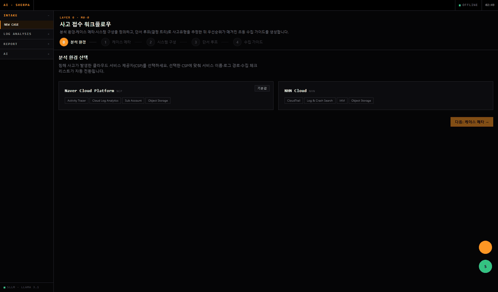

# AI Sherpa

AI Sherpa는 NCP와 NHN Cloud에서 침해사고를 조사할 때, 먼저 확보할 로그와 다음에 확인할 단서를 추천합니다.

2026년 1학기 · 세종대학교 정보보호 캡스톤 · 4인 팀 · 김병우 팀장

팀장으로 사고 추적 엔진, 수집 가이드, 로그 정규화, 조사 보드와 보고서 연동을 맡았습니다.

[최종 제출본](https://github.com/acvbbnm/cloud/tree/4bee0efe71e27249f05af0dc017abf80f9cc9f59) · [공동 저술 논문](https://github.com/acvbbnm/cloud/blob/4bee0efe71e27249f05af0dc017abf80f9cc9f59/docs/_team_paper.pdf) · [검증 기록](https://github.com/acvbbnm/cloud/blob/4bee0efe71e27249f05af0dc017abf80f9cc9f59/docs/3%EC%B6%95_%EA%B2%80%EC%A6%9D_%EB%B3%B4%EA%B3%A0%EC%84%9C.md)

시연에서는 Object Storage 활동만으로 사고 유형을 확정하기 어려운 사례를 다룹니다. 화면에서 백업 상태와 운영자 권한을 다음 확인 항목으로 제시합니다.

## 조사 과정

- [사고 접수와 단서 추천](docs/triage.md)에서 유형 후보의 점수가 어떻게 바뀌는지 볼 수 있습니다.
- [로그 수집과 정규화](docs/log-normalization.md)에서 두 클라우드의 로그를 공통 필드로 비교하는 방법을 설명합니다.
- [조사 보드와 보고서](docs/investigation-board.md)에서 사건 기록을 검토하고 보고서로 내보내는 흐름을 볼 수 있습니다.

이 문서의 시연과 보고서 화면은 최종 제출본 기준입니다. 기본 브랜치의 채팅과 보고서 화면은 개발 중 만든 예시입니다. [최종 제출본 실행 방법](docs/LOCAL_RUN.md)
