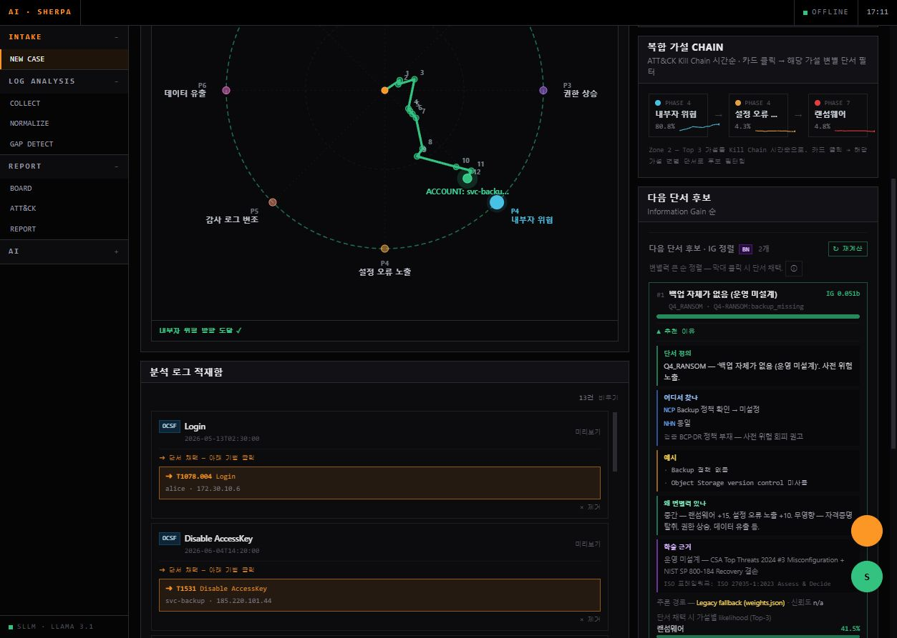
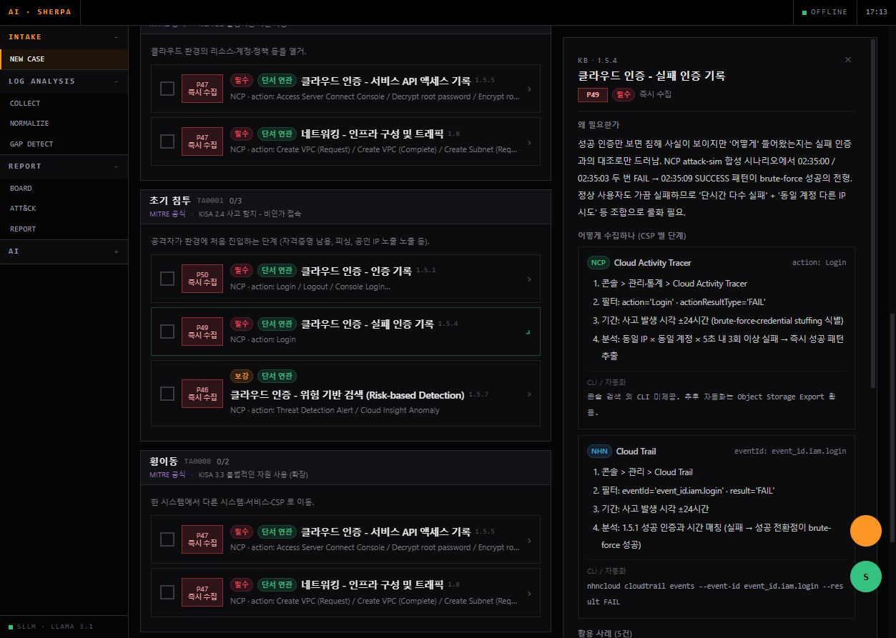
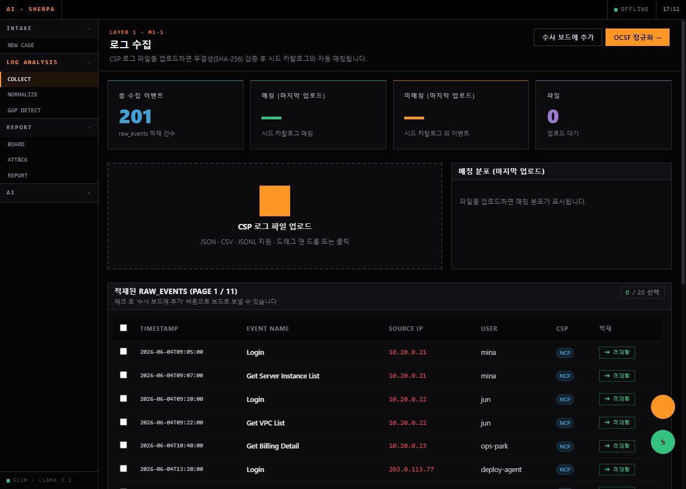
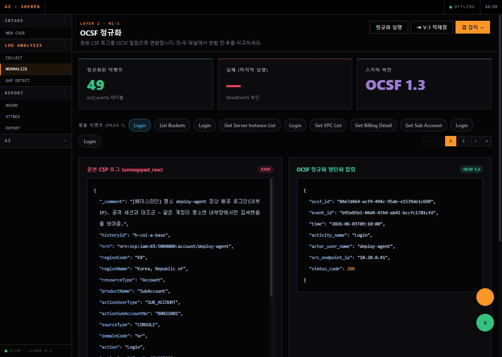
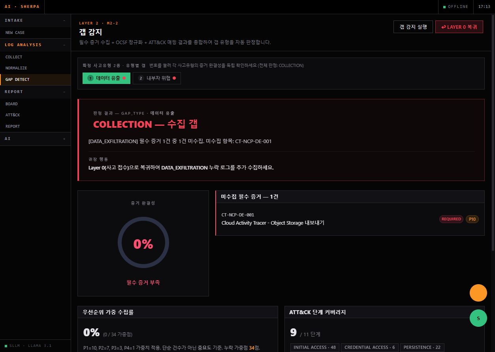
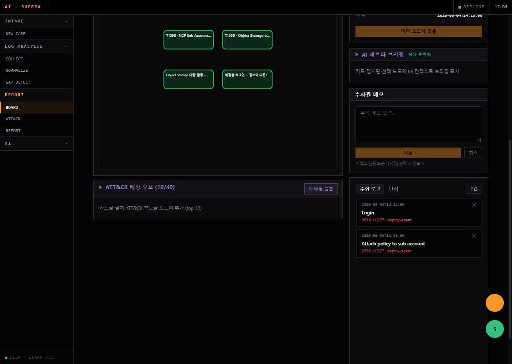
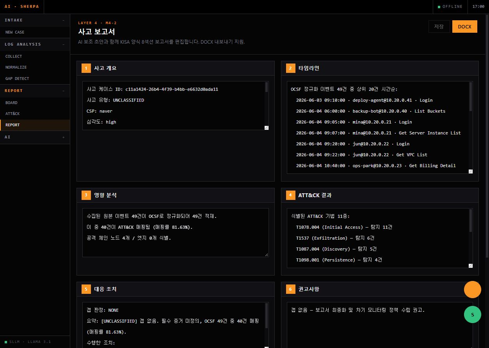
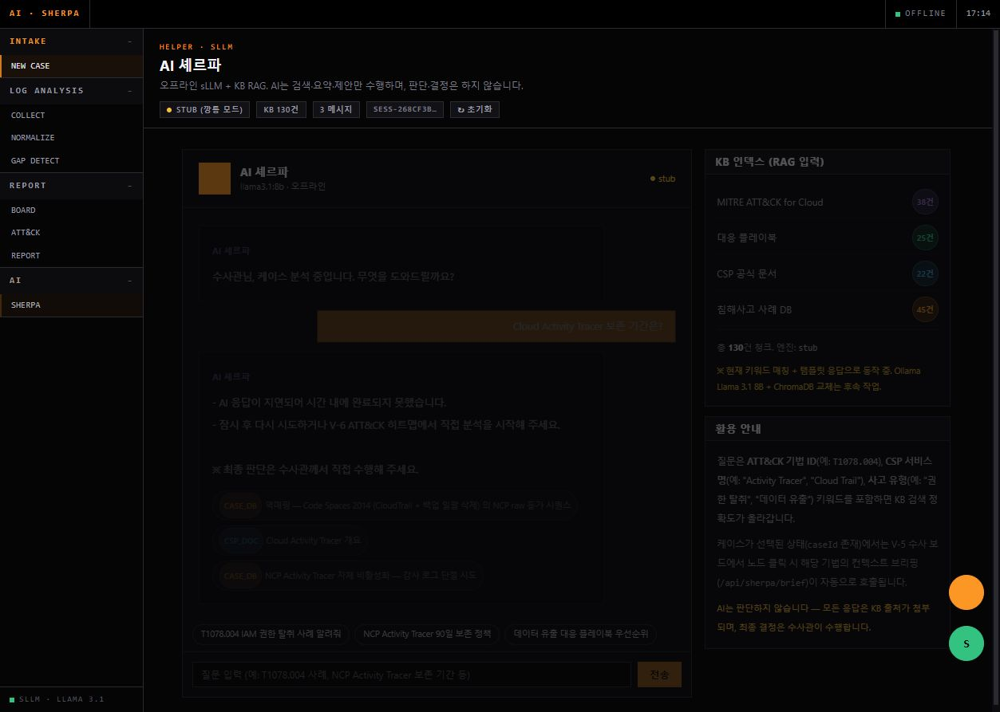

# AI Sherpa

**NCP·NHN Cloud 침해사고 조사 도구**

사고 신고의 단서로 어떤 로그부터 수집할지 정합니다.\
클라우드별 로그를 같은 형식으로 비교하고, 조사에 쓴 근거를 보드와 보고서에 남깁니다.

세종대학교 정보보호 캡스톤 · 2026년 1학기 · 로그아웃 팀

**[시스템 흐름 설계서 PDF](docs/시스템_플로우_상세보고서.pdf)** · [캡스톤 제출 논문 PDF](docs/_team_paper.pdf)

## 사고 접수와 수집 가이드

### 사고 가설과 다음 단서

단서를 채택하면 사고 유형별 점수를 다시 계산합니다.\
컴퍼스에 채택 순서를 표시하고, 가설을 구분하는 데 도움이 되는 단서를 추천합니다.\
추천 카드에서 단서를 어디서 찾을지, 어떤 가설을 구분하는 데 쓰이는지 확인할 수 있습니다.

[가설 계산과 후보 정렬](backend/core/intake/clue_tree_service.py) · [컴퍼스와 단서 화면](frontend/src/views/V1_Setup/Step3_EvidenceTreeDiscovery.tsx)

다음 단서의 추천 이유

### 수집 가이드

사고 유형과 클라우드에 맞는 수집 항목을 고르고, 채택한 단서와 관련된 항목의 우선순위를 높입니다.\
항목을 열면 해당 로그가 필요한 이유와 NCP·NHN Cloud에서 확인할 위치가 나옵니다.

[수집 우선순위 계산](backend/core/intake/collection_guide_v2.py) · [체크리스트와 항목 상세](frontend/src/views/V1_Setup/Step4_GuideChecklist_V2.tsx)

## 로그 수집과 분석

### 원본 로그 적재

업로드한 JSON을 클라우드별 파서로 읽습니다.\
원본 이벤트와 업로드 파일의 SHA-256 해시를 저장하고, 이벤트가 어떤 수집 항목에 해당하는지 연결합니다.

[업로드 처리](backend/api/ingestion.py) · [수집 항목 매칭](backend/core/ingestion/matchers.py)

로그 업로드와 적재 목록

### OCSF 정규화

NCP의 `action`과 NHN Cloud의 `eventId`를 `activity_name`에 넣습니다.\
출발지 IP도 `content.sourceIp`와 `userIp`에서 각각 읽어 `src_endpoint_ip`에 넣습니다.\
변환 뒤에도 원본 JSON을 저장해 화면에서 두 값을 대조할 수 있습니다.

[이벤트 변환](backend/core/analysis/ocsf_normalizer.py) · [NCP 필드 규칙](backend/data/mapping_rules/ncp_cloudtrail.json) · [NHN Cloud 필드 규칙](backend/data/mapping_rules/nhn_cloud_trail.json)

### ATT&CK 매핑과 수집 공백

정규화한 이벤트를 규칙과 대조해 ATT&CK 기법 후보를 표시합니다.\
수집 공백 화면에서는 사고 유형의 필수 증거 목록과 적재 기록을 대조해 추가로 확인할 로그를 보여줍니다.

[ATT&CK 매핑](backend/core/analysis/attack_mapper.py) · [수집 공백 판정](backend/core/analysis/gap_detector.py)

사고 유형별 수집 공백

## 조사 보드와 보고서

### 조사 보드

접수 단서와 ATT&CK 후보를 노드로 올립니다.\
노드를 직접 배치하고, 엣지 모드에서 시작과 끝 노드를 선택해 조사 순서나 관계를 선으로 남깁니다.

[노드 배치와 연결 UI](frontend/src/views/V5_Board/ChainGraphCanvas.tsx) · [연결 검증](backend/core/board/investigation_board.py)

### 사고 보고서

정규화한 이벤트로 타임라인을 만들고 ATT&CK 결과와 조사 근거를 초안에 넣습니다.\
조사자는 항목별로 내용을 편집하고 DOCX로 내보낼 수 있습니다.

[보고서 초안과 DOCX 생성](backend/core/board/report_generator.py)

## 셰르파 지식 검색

질문과 관련된 지식 문서를 찾아 답변에 출처를 붙입니다.\
아래 화면에서는 키워드 검색과 템플릿 응답으로 Cloud Activity Tracer 관련 문서를 조회했습니다.

[검색과 대체 경로](backend/core/sherpa/rag_retriever.py) · [답변 구성](backend/core/sherpa/ai_sherpa.py)

셰르파 응답과 출처

화면은 합성 로그로 실행한 결과입니다.
