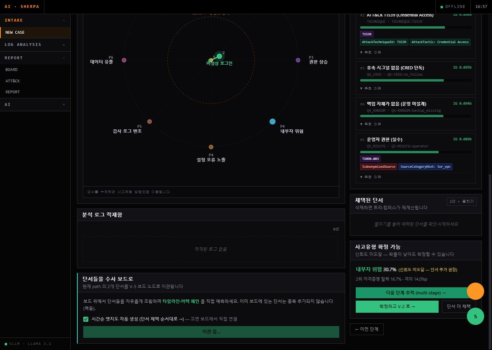
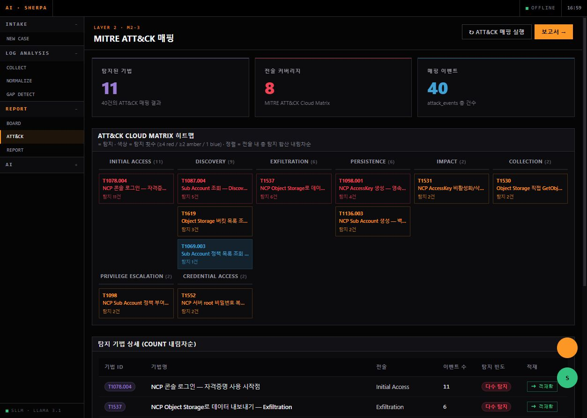

# AI Sherpa

**NCP·NHN Cloud 침해사고 조사 도구**

사고 신고의 단서로 어떤 로그부터 수집할지 정하고, 로그와 ATT&CK 기법 후보를 조사 보드에 모아 보고서로 정리합니다.

세종대학교 정보보호 캡스톤 · 2026년 1학기 · 로그아웃 팀

**[시스템 흐름 설계서 PDF](docs/시스템_플로우_상세보고서.pdf)** · [캡스톤 제출 논문 PDF](docs/_team_paper.pdf)

## 사고 접수와 수집 순서

NCP 합성 사례에 Object Storage 대량 활동과 비정상 로그인을 단서로 등록했습니다. 단서를 추가하면 사고 유형별 점수와 다음에 확인할 항목이 갱신됩니다.

## 로그 수집과 분석

NCP 시연 데이터 4개 파일에 담긴 로그 49건을 불러왔습니다. 수집 화면에서 로그인과 서브 계정 권한 변경 기록을 선택해 보드로 보냈습니다.

원본과 OCSF 필드를 나란히 비교할 수 있습니다. 로그인 이벤트의 작업명, 계정, 출발지 IP가 공통 필드에 각각 어떻게 들어가는지 확인했습니다.

ATT&CK 매핑 결과는 40건이었고, 기법 11종이 표시됐습니다. 기법별 이벤트를 열어 조사할 후보를 고를 수 있습니다.

## 조사 보드와 보고서

접수 단서와 서브 계정 권한 변경·Object Storage 객체 조회 후보를 한 보드에 모았습니다. 오른쪽 수집 로그에서 로그인과 권한 변경 기록을 함께 확인할 수 있습니다.

보고서 초안에서는 정규화한 로그를 시간순으로 검토하고, ATT&CK 매핑 결과와 대응 조치를 편집할 수 있습니다.

위 화면은 제출본의 합성 사례를 로컬에서 실행해 촬영했습니다. NCP 콘솔에서 Activity Tracer 로그를 내보내는 절차는 시연 가이드에 있습니다.

[시연 대본](docs/시연_대본.md) · [NCP·NHN Cloud 시연 자료](시연_시나리오/)
