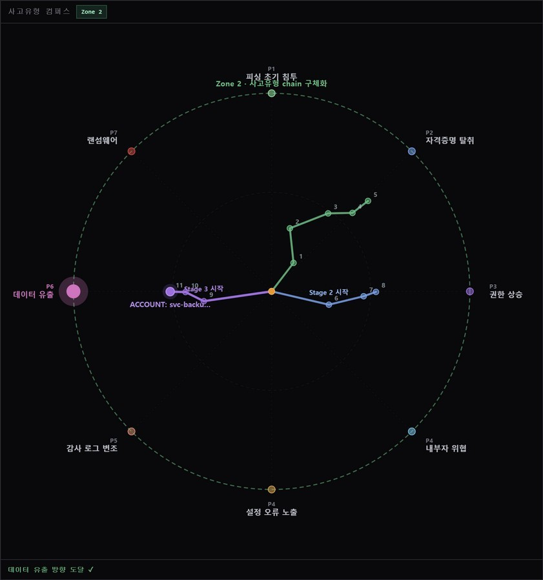

# 사고 접수와 단서 추천

설문에서 조사 초기에 어떤 로그를 먼저 봐야 할지 정하기 어렵다는 응답이 있었습니다. 사고 유형을 좁히는 데 도움이 되는 단서부터 보여주도록 설계했습니다.

## 후보 점수와 수집 순서

1. 조사자가 사고를 등록하고 NCP 또는 NHN Cloud를 선택합니다.
2. 단서를 추가하면 사고 추적 엔진이 유형 후보의 점수를 다시 계산합니다.
3. 엔진은 후보의 불확실성을 얼마나 줄일 수 있는지 계산해 다음 단서를 정렬합니다. 이 값이 정보이득입니다.
4. 조사자는 수집 가이드에서 먼저 볼 로그와 보강할 증거를 확인합니다.

## Object Storage 활동을 확인한 경우

합성 사례에서 Object Storage 대량 활동을 추가하자 데이터 유출과 랜섬웨어의 모델 점수가 각각 21%였습니다. 화면은 판단을 보류하고 백업 상태와 운영자 권한을 다음 확인 항목으로 제시했습니다. 점수는 해당 사례에 입력된 단서를 기준으로 계산한 값입니다.

[사고 추적 엔진](https://github.com/acvbbnm/cloud/blob/4bee0efe71e27249f05af0dc017abf80f9cc9f59/backend/core/intake/bayes_net.py) · [정보이득 계산](https://github.com/acvbbnm/cloud/blob/4bee0efe71e27249f05af0dc017abf80f9cc9f59/backend/core/intake/info_gain.py) · [수집 가이드](https://github.com/acvbbnm/cloud/blob/4bee0efe71e27249f05af0dc017abf80f9cc9f59/backend/core/intake/collection_guide_v2.py)
