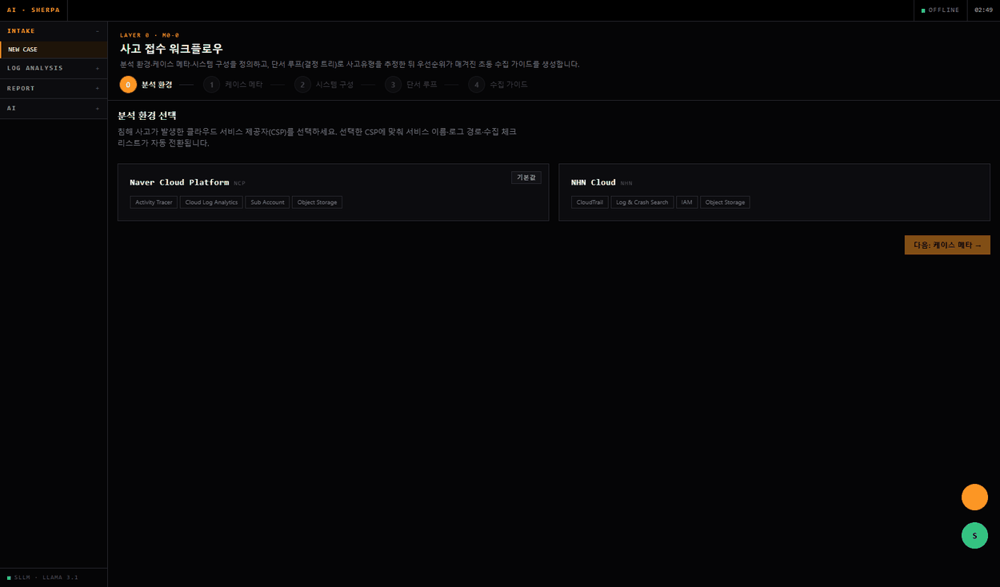

# AI Sherpa 보고서와 시연

사고가 의심될 때 조사자가 어떤 로그를 먼저 확보하고, 다음에 무엇을 확인할지 정하는 과정을 다룹니다. 아래 시연과 화면은 최종 제출본 기준입니다.

[시스템 흐름 보고서 PDF](https://github.com/acvbbnm/cloud/blob/4bee0efe71e27249f05af0dc017abf80f9cc9f59/docs/시스템_플로우_상세보고서.pdf) · [공동 저술 논문 PDF](https://github.com/acvbbnm/cloud/blob/4bee0efe71e27249f05af0dc017abf80f9cc9f59/docs/_team_paper.pdf)

## 사고 등록과 다음 단서

합성 사례에서 Object Storage 대량 활동을 추가하자 데이터 유출과 랜섬웨어의 모델 점수가 같았습니다. 화면은 유형 판단을 보류하고 백업 상태와 운영자 권한을 다음 확인 항목으로 제시했습니다. [사고 접수와 단서 추천](../docs/triage.md)

## 조사 보드와 보고서

최종 제출본에서 같은 사건의 조사 보드와 보고서를 연 화면입니다. 조사 보드에서는 사건에 연결한 로그와 기법 후보를 검토합니다. 보고서 화면에서는 사건의 개요, 타임라인과 대응 조치를 정리합니다.

[조사 보드 화면](https://github.com/acvbbnm/cloud/blob/4bee0efe71e27249f05af0dc017abf80f9cc9f59/docs/draft_final_report/options/captures/V_board_with_case.png) · [보고서 화면](https://github.com/acvbbnm/cloud/blob/4bee0efe71e27249f05af0dc017abf80f9cc9f59/docs/draft_final_report/options/captures/V_report_with_case.png)

[로그 수집과 정규화](../docs/log-normalization.md) · [조사 보드의 구성과 데이터 모델](../docs/investigation-board.md) · [최종 제출본 로컬 실행](../docs/LOCAL_RUN.md)
